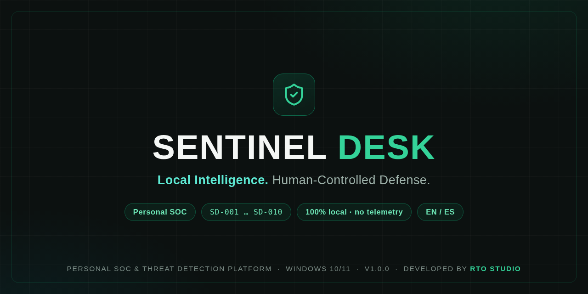
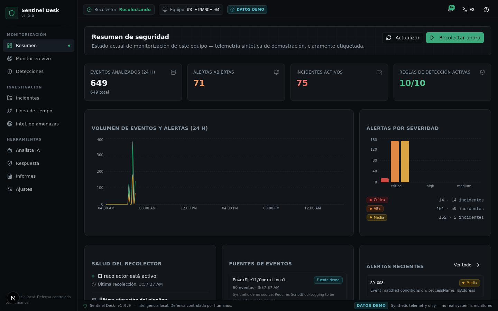
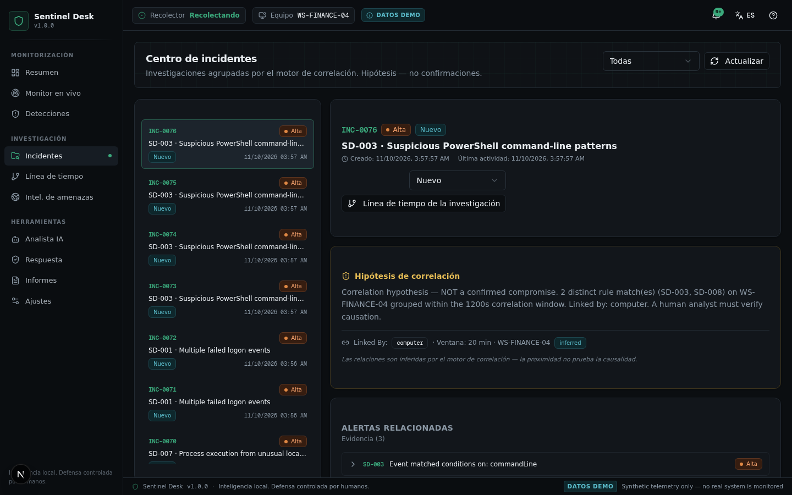
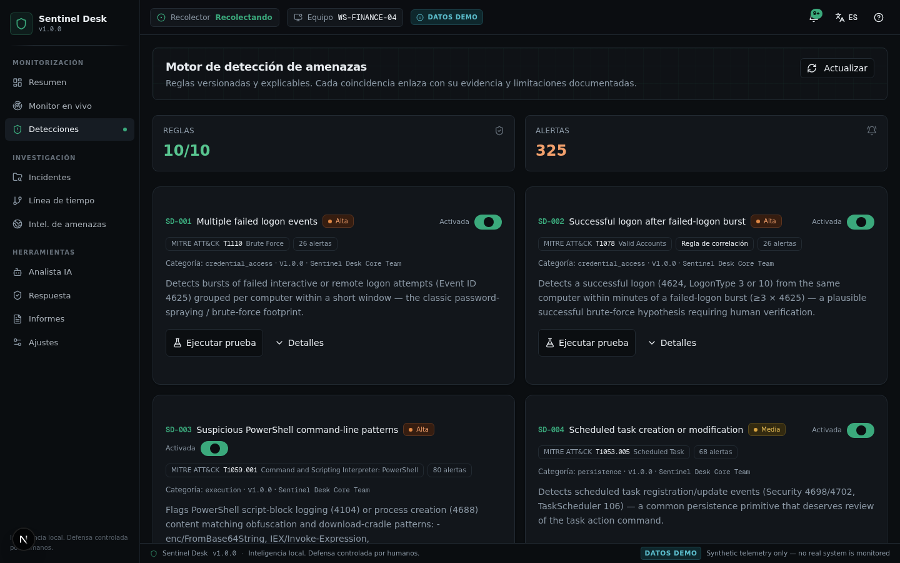

<div align="center">
  
</div>

# 🛡️ Sentinel Desk

<div align="center">

**Plataforma personal de SOC y detección de amenazas — Inteligencia local. Defensa controlada por humanos.**

*Desarrollado por **Ramón Taboada Olivella — RTO Studio*** · [github.com/rtostudioco](https://github.com/rtostudioco)


[🇬🇧 English](README.md) · **🇪🇸 Español**

</div>

Sentinel Desk es un asistente *local-first* de investigación de operaciones de seguridad. Recolecta eventos de seguridad de Windows, los normaliza a un esquema común, los evalúa contra **10 reglas de detección versionadas y explicables** (`SD-001 … SD-010`), correlaciona actividad relacionada dentro de ventanas temporales, la agrupa en incidentes de investigación y explica los hallazgos mediante un analista de IA opcional — manteniendo **el control humano sobre cada conclusión y cada acción**.

> **Aviso:** Sentinel Desk es una *herramienta de investigación y aprendizaje de SOC personal*. **No** es un EDR, ni un antivirus, ni un reemplazo de Microsoft Defender ni de un SIEM empresarial. Nunca modifica tu sistema: la v1.0 es de solo lectura + orientativa. En esta compilación del repositorio, la fuente de eventos es una **fuente demo sintética claramente etiquetada** (`synthetic=true` en cada evento, insignia DEMO permanente en la interfaz) — nada lee un sistema real y ningún evento se presenta como telemetría real. Un puerto Tauri 2 + Rust que sustituye la fuente sintética por un colector real de EVTX se incluye en [`desktop/`](desktop/) y compila instaladores de Windows mediante GitHub Actions.

---

## ✨ Características

- **Pipeline de detección completo** — recolector → normalizador → motor de detección → correlación → motor de incidentes → SQLite → UI. Cada ejecución del pipeline informa estado por etapa, conteos de entrada/salida, errores y duración; los eventos nunca desaparecen en silencio.
- **10 reglas de detección versionadas** (`SD-001`…`SD-010`) con mapeo a MITRE ATT&CK, campos de evidencia, notas de falsos positivos y limitaciones — cada una testeable contra un fixture sintético inofensivo desde la interfaz.
- **Correlación con etiquetas de honestidad** — ventana temporal + vinculación por host/usuario/proceso; toda relación se etiqueta explícitamente como `inferred` (inferida), y la proximidad nunca afirma causalidad.
- **Incident Storytelling (la característica definitoria)** — cinco capas estrictamente separadas: *Hechos observados* · *Coincidencias de reglas* · *Hipótesis de correlación* · *Interpretaciones generadas por IA* · *Conclusiones confirmadas por humanos*. El producto nunca confirma un compromiso automáticamente.
- **Máquina de estados de incidentes** — Nuevo → Investigando → Monitoreando → Resuelto / Falso Positivo, con notas del analista y registro de auditoría completo.
- **Línea de tiempo de investigación interactiva** — reconstrucción cronológica + grafo de relaciones (SVG) con alternativa accesible en lista.
- **Inteligencia de amenazas** — validación de formato de indicadores (hash / IP / dominio / URL), heurísticas locales, trazabilidad por indicador; la consulta externa requiere consentimiento y está desactivada por diseño en esta compilación.
- **Analista de Seguridad IA opcional** — explicación de incidentes con LLM, redacción obligatoria de datos sensibles, registro de auditoría completo (proveedor / modelo / versión de prompt), fallback determinista si el proveedor no responde.
- **Centro de Respuesta (solo orientativo)** — listas de verificación que explican qué *podría* hacer un analista. **No existe remediación automática.**
- **Informes SOC** — informe JSON con metadatos de integridad SHA-256, exportaciones CSV (eventos / alertas), vista previa ejecutiva imprimible a PDF.
- **Interfaz bilingüe (English / Español)** — cambio de idioma con un clic, persistido localmente.
- **Puerto de escritorio incluido** — [`desktop/`](desktop/) contiene el backend Tauri 2 + Rust (colectores reales de EVTX, las mismas 10 reglas, la misma semántica de correlación) con un workflow de GitHub Actions que compila instaladores `.msi` / `.exe`.

---

## 📸 Capturas de pantalla

| Resumen de seguridad — KPIs del pipeline, severidad, salud de fuentes | Centro de incidentes — hipótesis de correlación, narrativa de cinco capas |
|---|---|
|  |  |



---

## 🧱 Stack tecnológico

| Capa | Tecnología |
|---|---|
| Runtime | Node.js ≥ 20 / Bun ≥ 1.1 |
| Framework | Next.js 16 (App Router) + TypeScript 5 (estricto) |
| UI | Tailwind CSS 4, shadcn/ui (New York), lucide-react |
| Estado | Helpers de fetch tipados + componentes de servidor; persistencia local para ajustes de UI |
| Base de datos | SQLite vía Prisma ORM (10 entidades, esquema versionado) |
| Sistema de diseño | "SOC Editorial" — superficies grafito profundo, acentos esmeralda/cian contenidos, paleta de severidad semántica, IDs en monospace |
| Puerto de escritorio | Tauri 2 + Rust (colector EVTX con windows-rs, rusqlite, pipeline Tokio) |
| IA (opcional) | Proveedor LLM detrás de un adaptador con consentimiento y redacción, solo en el servidor |

---

## 📂 Estructura del proyecto

```
src/
├── app/
│   ├── page.tsx                  # Consola SOC de una sola página (10 módulos)
│   └── api/
│       ├── collector/            # POST — ejecutar lote de recolección · GET — estado del recolector
│       ├── events/               # GET — consulta paginada de eventos + [id] detalle (payload original)
│       ├── rules/                # GET — catálogo de reglas · POST — prueba fixture de una regla
│       ├── incidents/            # GET — lista / [id] detalle · PATCH — estado · notas
│       ├── overview/             # GET — KPIs del panel, tendencias, salud de fuentes
│       ├── reports/              # GET — informe JSON (SHA-256) + exportaciones CSV
│       ├── ai/analyze            # POST — análisis de incidente con consentimiento y redacción
│       ├── ti/                   # POST — consulta de indicadores + análisis (heurísticas locales)
│       └── settings/             # GET/PUT — ajustes de la aplicación
├── components/
│   ├── layout/                   # header (estado del recolector, notificaciones, i18n, ayuda)
│   ├── views/                    # las 10 vistas de módulos
│   └── ui/                       # primitivas shadcn/ui
└── lib/
    ├── engine/                   # pipeline.ts · normalizer.ts · detection.ts · rules.ts · generator.ts
    ├── ai.ts                     # adaptador de IA con consentimiento (redacción + registro de auditoría)
    ├── bootstrap.ts              # siembra inicial (reglas + ajustes)
    ├── db.ts                     # cliente Prisma
    └── i18n.ts                   # textos EN / ES
desktop/                          # Puerto Tauri 2 + Rust — colectores EVTX reales, CI MSI/NSIS
prisma/                           # schema.prisma (SQLite, 10 entidades)
docs/                             # arquitectura, seguridad, reglas, instalación, limitaciones
```

---

## 🚀 Primeros pasos

### Requisitos
- **Node.js 20+** (o Bun 1.1+) — no se necesita servidor de base de datos, SQLite es embebida.
- El recolector demo sintético viene integrado: **sin permisos de administrador, sin acceso a sistemas reales, sin requerir Windows** (corre en cualquier sistema operativo).

### Instalar y ejecutar

```bash
# 1. Instalar dependencias
bun install            # o: npm install

# 2. Crear/actualizar el esquema SQLite (db/sentinel.db)
bun run db:push        # o: npx prisma db push

# 3. Iniciar la app
bun run dev            # o: npm run dev  →  http://localhost:3000
```

Luego abre **Monitor en vivo → Recolectar ahora** (o activa los lotes automáticos en **Ajustes → Recolector**). Los eventos fluyen por el pipeline, las alertas aparecen en **Detecciones**, los casos correlacionados aparecen en **Incidentes**. Todas las pantallas llevan la insignia permanente de **datos DEMO**.

### Probar una regla de detección

Cada regla incluye un fixture sintético inofensivo y puede ejecutarse en modo prueba desde la interfaz (**Detecciones → Ejecutar prueba**) o con una llamada HTTP:

```bash
curl -X POST localhost:3000/api/rules/SD-001/test
```

---

## 🔒 Modelo de seguridad

Sentinel Desk está construido para ser **seguro de ejecutar**:

- ✅ **Solo lectura por diseño**: no existe ruta de código que mate procesos, borre archivos, modifique el registro, altere servicios/tareas/reglas de firewall ni desactive tu antivirus.
- ✅ **Sin elevación de privilegios**: nunca pide permisos de administrador; las fuentes degradadas se reportan honestamente como no disponibles.
- ✅ **Procedencia explícita**: cada evento lleva su fuente, canal, ID de registro y bandera `synthetic`; cada alerta lista sus eventos de evidencia; cada incidente lista sus alertas.
- ✅ **La inferencia está etiquetada**: las relaciones de correlación se marcan `inferred` — la proximidad nunca se presenta como causalidad.
- ✅ **Sin fallos silenciosos**: las etapas del pipeline reportan errores; la retención elimina con visibilidad, nunca en silencio.
- ✅ **Sin telemetría**: todos los datos permanecen en tu archivo SQLite local. Sin cuenta en la nube, sin llamadas a casa.
- ✅ **La IA no puede actuar**: la capa de IA no puede crear evidencia, modificar reglas, ejecutar nada ni declarar un compromiso confirmado — reforzado en los textos del producto, el contrato de prompt y la ausencia total de capacidad de ejecución.

### Módulo de IA opcional
- Lee **solo** la evidencia del incidente que selecciones — nada más.
- Los valores sensibles (hostnames, usuarios, IPs, blobs base64) se **redactan antes de cualquier llamada al modelo** cuando el modo privacidad está activo (activado por defecto).
- Cada análisis se guarda con proveedor, modelo, modo de privacidad, versión de prompt, la entrada exacta redactada y la salida.
- La aplicación es **completamente funcional sin él**.

---

## 📊 Las diez reglas de detección

| Regla | Nombre | MITRE ATT&CK | Tipo | Fixture |
|------|------|--------------|------|---------|
| SD-001 | Múltiples eventos de inicio de sesión fallido | T1110 Brute Force | Umbral | ✅ pasa |
| SD-002 | Inicio de sesión exitoso tras ráfaga de fallos | T1078 Valid Accounts | Correlación | ✅ pasa |
| SD-003 | Patrones sospechosos en línea de comandos de PowerShell | T1059.001 | Evento único | ✅ pasa |
| SD-004 | Creación o modificación de tarea programada | T1053.005 | Evento único | ✅ pasa |
| SD-005 | Creación de nuevo servicio | T1543.003 | Evento único | ✅ pasa |
| SD-006 | Cambios de configuración de seguridad | T1562 Impair Defenses | Evento único | ✅ pasa |
| SD-007 | Ejecución de proceso desde ubicación inusual | T1036.005 | Evento único | ✅ pasa |
| SD-008 | Actividad de red sospechosa asociada a proceso | T1071 (requiere Sysmon) | Evento único | ✅ pasa |
| SD-009 | Posible secuencia de persistencia | T1053.005 | Correlación | ✅ pasa |
| SD-010 | Actividad sospechosa multi-señal | T1059 | Correlación | ✅ pasa |

Las reglas viven en [`src/lib/engine/rules.ts`](src/lib/engine/rules.ts) en un formato JSON portable inspirado en Sigma (umbrales, condiciones, señales de correlación) diseñado para migrar al motor Rust sin cambios — y ya lo hicieron, en [`desktop/`](desktop/). Cada regla incluye campos de evidencia, notas de falsos positivos y limitaciones, visibles en la vista Detecciones. Ver [`docs/DETECTION-RULES.md`](docs/DETECTION-RULES.md).

---

## 🖥️ Los diez módulos

1. **Resumen de Seguridad** — KPIs en vivo, tendencia 24h, distribución por severidad, salud del recolector, estado de fuentes, última ejecución del pipeline.
2. **Monitor en Vivo** — tabla de eventos con filtros + paginación, panel de detalle con procedencia y payload original, control del recolector.
3. **Motor de Detección de Amenazas** — 10 reglas versionadas, activar/desactivar, banco de pruebas por regla, metadatos (lógica, falsos positivos, limitaciones).
4. **Correlación de Eventos** — ventana temporal + vinculación por host/usuario/proceso con etiquetas explícitas inferido-vs-observado.
5. **Centro de Incidentes** — casos con flujo de estados, listas de evidencia, notas del analista, hipótesis de correlación.
6. **Línea de Tiempo de Incidentes** — reconstrucción cronológica + grafo de relaciones SVG + alternativa accesible en lista.
7. **Inteligencia de Amenazas** — validación de indicadores, heurísticas locales, trazabilidad de eventos, consulta externa con consentimiento.
8. **Analista de Seguridad IA** — explicación de incidentes con redacción obligatoria y registro de auditoría completo, disciplina de cinco capas.
9. **Centro de Respuesta** — solo listas de verificación orientativas. No existe remediación automática.
10. **Informes SOC** — informe JSON con integridad SHA-256, exportaciones CSV, vista previa ejecutiva imprimible a PDF.

---

## 🗄️ Modelo de datos (SQLite / Prisma)

`Event` · `EventSource` · `DetectionRule` · `Alert` · `Incident` · `IncidentEvent` · `IncidentNote` · `AiAnalysis` · `Setting` · `AuditLog` — IDs UUID estables, marcas de tiempo UTC, tablas de referencia de evidencia, consultas indexadas, política de retención. Ver `prisma/schema.prisma`.

---

## 🧪 Calidad

```bash
bun run lint          # ESLint (reglas de Next.js)
bunx tsc --noEmit     # verificación de tipos estricta
curl -X POST localhost:3000/api/rules/SD-001/test   # pruebas fixture de reglas, una llamada por regla
```

---

## 📦 Empaquetado / distribución (instaladores de Windows)

Este repositorio incluye un **puerto de escritorio Tauri 2** ([`desktop/`](desktop/)) cuya CI compila instaladores reales de Windows desde tu propia cuenta de GitHub:

1. Sube este repositorio a GitHub (guía abajo).
2. Sube una etiqueta: `git tag v1.0.0 && git push origin v1.0.0` — o ejecuta el workflow manualmente desde la pestaña **Actions**.
3. Abre la ejecución del workflow → **Artifacts** → descarga `sentinel-desk-windows` (`Sentinel Desk_1.0.0_x64_en-US.msi` / `_x64-setup.exe`).

> **Nota de honestidad:** los instaladores compilados por CI se generan en los runners `windows-latest` de GitHub. El código Rust se escribió para ser correcto, pero no se ha ejecutado en una máquina física Windows desde este entorno de desarrollo — espera reportar incidencias en la primera ejecución. El prototipo web, en cambio, está completamente verificado en navegador.

Para compilaciones de escritorio manuales y requisitos, ver [`docs/INSTALLATION.md`](docs/INSTALLATION.md) y [`desktop/docs/IMPLEMENTATION-STATUS.md`](desktop/docs/IMPLEMENTATION-STATUS.md) (matriz honesta por módulo).

---

## 📚 Documentación

- [`docs/ARCHITECTURE.md`](docs/ARCHITECTURE.md) — mapa de módulos, flujo de datos, esquema de base de datos, ruta de portado a Tauri/Rust
- [`docs/SECURITY.md`](docs/SECURITY.md) — modelo de seguridad: mínimo privilegio, recolección de solo lectura, redacción, consentimiento, registro de auditoría
- [`docs/INSTALLATION.md`](docs/INSTALLATION.md) — instalación, configuración, gestión de datos
- [`docs/DETECTION-RULES.md`](docs/DETECTION-RULES.md) — formato de reglas, catálogo, metodología de pruebas
- [`docs/LIMITATIONS.md`](docs/LIMITATIONS.md) — limitaciones conocidas y límites honestos (lee antes de confiar en nada)

## 🚫 Lo que Sentinel Desk NO es

- No es un EDR, antivirus, ni reemplazo de Microsoft Defender.
- No es un SIEM empresarial (no se afirma equivalencia con Splunk/Sentinel/QRadar).
- No es un producto certificado de cumplimiento.
- **No es capaz de modificar tu sistema** — la v1.0 es de solo lectura + orientativa.
- En esta compilación del repositorio: no está conectado a telemetría real de Windows (fuente sintética, etiquetada permanentemente).

## 📄 Licencia

MIT — ver [LICENSE](LICENSE).

## 🐛 Divulgación responsable

¿Encontraste un problema de seguridad en Sentinel Desk? Por favor abre una **advisory de seguridad privada** vía GitHub (Security → Report a vulnerability) en lugar de un issue público. No incluyas logs reales, credenciales ni datos personales en ningún issue.
