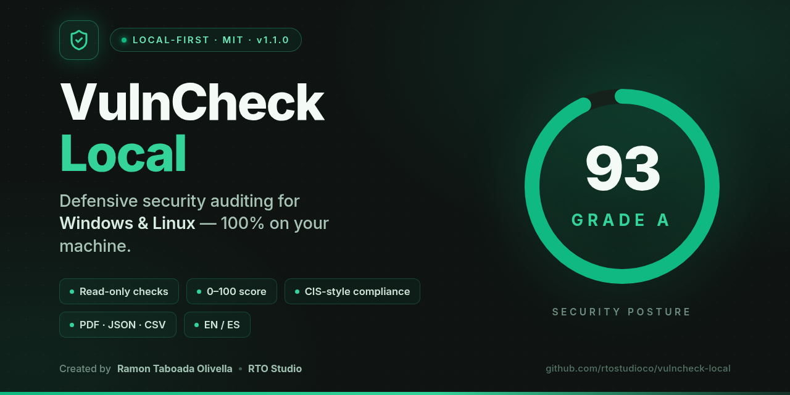
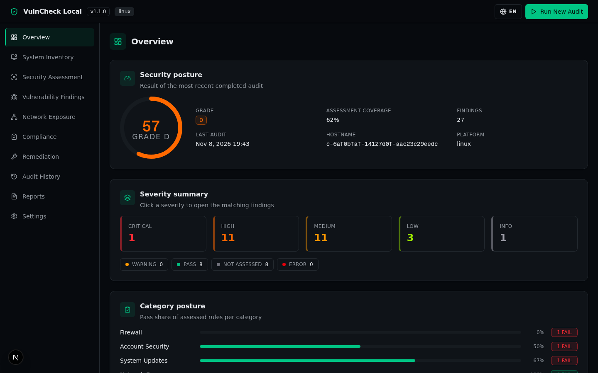
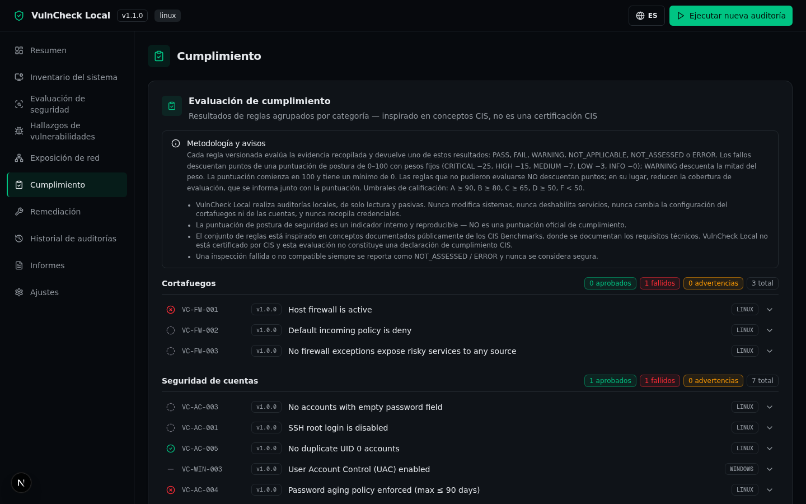
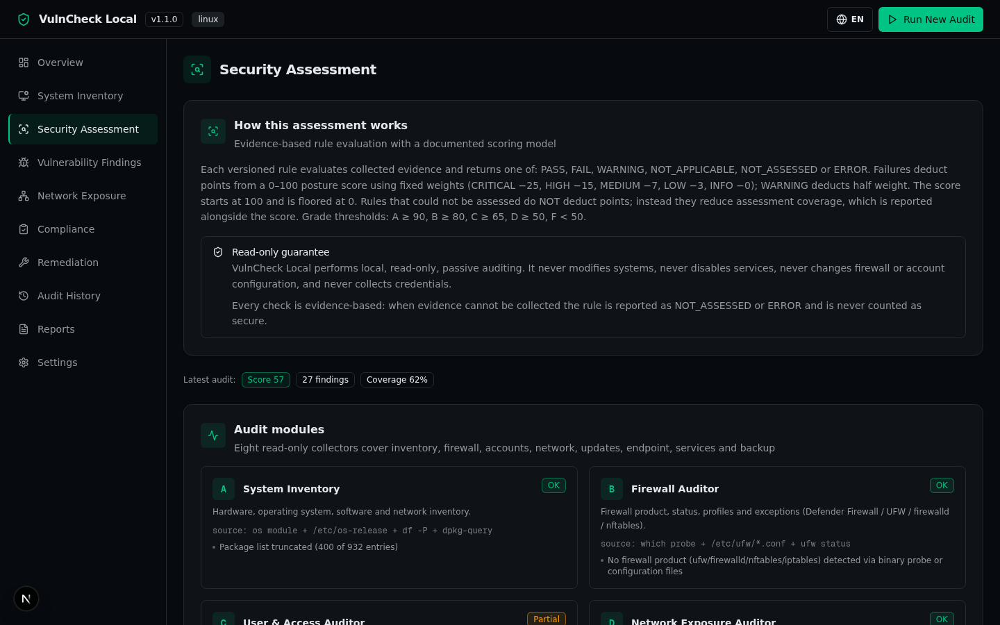

<div align="center">
  
</div>

# 🛡️ VulnCheck Local

<div align="center">

**Local-first defensive security auditing for your own machines.**


</div>

VulnCheck Local runs entirely on the machine being audited. It inventories the host, executes **read-only** security checks, scores the result from 0–100, maps findings to CIS-style control categories, and produces professional **PDF / JSON / CSV** reports — with **no cloud account, no telemetry, and no data leaving the machine** (except one optional, explicitly consented AI feature).

> **Disclaimer:** VulnCheck Local is a *defensive, self-audit* tool. It never exploits, never modifies your system, and never claims to be a certified CIS assessment. "CIS Benchmarks" are referenced for guidance only. Results are advisory — always verify remediation steps with your administrator.

---

## ✨ Features

- **Automatic platform detection** — activates the matching audit modules for Linux (Ubuntu/Debian) or **Windows (PowerShell collectors, see [docs/WINDOWS.md](docs/WINDOWS.md))**.
- **Bilingual UI (English / Español)** — one-click language switcher in the header, persisted locally.
- **System inventory** — OS/build, kernel, CPU, memory, disks (with usage bars), network interfaces, package count, uptime.
- **27 versioned security rules** (`VC-XX-NNN`) across firewall, accounts, endpoint protection, services, network exposure, updates and backup.
- **Honest check states** — every rule resolves to `PASS`, `FAIL`, `WARNING`, `NOT_APPLICABLE`, `NOT_ASSESSED` or `ERROR`. A check that could not be assessed is **never** reported as "secure": it simply reduces the reported *coverage*.
- **Documented, reproducible scoring** — see [Scoring](#-scoring-methodology).
- **Network exposure view** — listening TCP/UDP ports grouped by bind scope (`0.0.0.0`/`::` highlighted as risky), passive detection only (no port scanning of other hosts).
- **Compliance page** — grouped by control category with CIS-style references (unofficial).
- **Remediation center (display-only)** — problem, impact, fix, and verification steps per failed check. v1.0 **never executes fixes**.
- **Audit history** — every run persisted in SQLite with score, grade, coverage and findings.
- **Report exports** — branded PDF, machine-readable JSON, spreadsheet-ready CSV; download history tracked.
- **Optional AI explanations** — fully opt-in; disabled by default; see [AI module](#-optional-ai-module).

---

## 📸 Screenshots

| Overview — score, severity & category posture | Compliance — CIS-style, in Español |
|---|---|
|  |  |



---

## 🧱 Tech stack

| Layer | Technology |
|---|---|
| Runtime | Node.js ≥ 20 / Bun ≥ 1.1 |
| Framework | Next.js 16 (App Router) + TypeScript 5 (strict) |
| UI | Tailwind CSS 4, shadcn/ui (New York), lucide-react, framer-motion |
| State | Zustand (client), typed fetch helpers |
| Database | SQLite via Prisma ORM (schema versioned via `DbMeta`) |
| Exports | jsPDF + jspdf-autotable (PDF), JSON, CSV |
| AI (optional) | z-ai-web-dev-sdk, server-side only |

---

## 📂 Project structure

```
src/
├── app/
│   ├── page.tsx                  # Single-page dashboard (10 sections)
│   └── api/
│       ├── audit/run             # POST — start a new audit session
│       ├── audit/sessions        # GET/POST — list / delete sessions
│       ├── meta                  # GET — engine version, rule count, settings
│       ├── reports/pdf           # GET  — branded PDF export
│       ├── reports/export        # GET  — JSON / CSV export
│       ├── reports/history       # GET — export history
│       ├── settings              # GET/PUT — AI consent, retention
│       └── ai/explain            # POST — consent-gated AI explanation
├── components/dashboard/         # Overview, Inventory, Assessment, Findings,
│                                 # Network Exposure, Compliance, Remediation,
│                                 # History, Reports, Settings
└── lib/vulncheck/
    ├── core/                     # platform detection, strict command runner, types
    ├── collectors/               # linux/* evidence collectors (8 modules)
    ├── auditors/engine.ts        # orchestrates rules against evidence
    ├── compliance/rules/         # versioned rule registry (linux + windows)
    ├── scoring/score.ts          # documented scoring model
    ├── reporting/                # pdf.ts, exports.ts, history.ts
    ├── ai/explain.ts             # consent-gated, data-minimized AI module
    └── db/                       # repo + seed
```

---

## 🚀 Getting started

### Prerequisites
- **Node.js 20+** (or Bun 1.1+) — live evidence collection on Linux (Ubuntu 22.04/24.04, Debian 12) and Windows 10/11 via read-only PowerShell collectors ([docs/WINDOWS.md](docs/WINDOWS.md)).
- No database server needed — SQLite is embedded.

### Install & run

```bash
# 1. Install dependencies
bun install            # or: npm install

# 2. Configure the database path
cp .env.example .env   # default: file:./db/custom.db

# 3. Create/refresh the schema
bun run db:push        # or: npx prisma db push

# 4. Start the app
bun run dev            # or: npm run dev  →  http://localhost:3000
```

Then click **Run New Audit** in the header. Progress is streamed live; when it completes you land on the Overview with your score, grade and findings.

### Run checks against your machine

The audit reads information via a **strict command allowlist** (see below) plus Node's `os`/`fs` APIs. Some checks benefit from password-less `sudo` (e.g. `ufw status`) — without it those checks are reported as `NOT_ASSESSED`, never guessed.

---

## 🔒 Security model

VulnCheck Local is built to be **safe to run on your own machine**:

- ✅ **Read-only**: every command invoked is a read-only inspection query.
- ✅ **Strict allowlist** (`src/lib/vulncheck/core/runner.ts`): only registered command IDs with exact argument sets can run; no shell is spawned (`execFile`, `shell: false`), no string interpolation, timeouts and output-size limits on every call.
- ✅ **Data minimization**: no credentials, passwords, hashes, tokens or key material are ever collected. Evidence is limited to security-relevant configuration state.
- ✅ **No persistence changes**: the tool never enables/disables services, never edits firewall rules, never creates accounts, never installs anything.
- ✅ **No remote scanning**: network exposure is derived from *local* listening sockets only.
- ✅ **No telemetry**: all data stays in your local SQLite file.

### Optional AI module
- **Off by default.** You must explicitly enable *AI consent* in Settings.
- When enabled, explaining a finding sends **only that single finding's metadata** — never the full inventory, never hostnames, never other findings. Evidence excerpts are sanitized (IPs/MACs replaced) and truncated to 600 characters.
- The application is **fully functional without it**.

---

## 📊 Scoring methodology

Deterministic and reproducible on identical evidence:

| Element | Rule |
|---|---|
| Starting score | **100** |
| `FAIL` deduction | CRITICAL −25 · HIGH −15 · MEDIUM −7 · LOW −3 · INFO −0 |
| `WARNING` deduction | Half the `FAIL` weight |
| `NOT_ASSESSED` / `ERROR` | **No deduction** — reduces *coverage %* instead |
| Floor | 0 |
| Grades | A ≥ 90 · B ≥ 80 · C ≥ 65 · D ≥ 50 · F < 50 |

Coverage (share of rules that could actually be assessed) is always reported **next to** the score, so a "high score with low coverage" cannot be mistaken for a good result.

---

## 🖥️ Dashboard sections

1. **Overview** — score ring, grade, coverage, severity stats, category posture, module health, limitations.
2. **System Inventory** — host, OS, hardware, disks, interfaces, packages.
3. **Security Assessment** — methodology, live progress, module cards A–H.
4. **Findings** — filter by severity/category/status; expandable evidence, risk explanation, remediation and verification.
5. **Network Exposure** — listening sockets, bind scope, risky exposure summary.
6. **Compliance** — control categories with pass/fail per rule (CIS-style, unofficial).
7. **Remediation Center** — display-only guides (problem → impact → fix → verification).
8. **Audit History** — reload or delete past sessions, retention policy.
9. **Reports** — PDF/JSON/CSV downloads with export history.
10. **Settings** — AI consent, data retention, engine info, danger zone.

---

## 🗄️ Data model (SQLite / Prisma)

`SystemProfile` · `AuditSession` · `AuditFinding` · `SecurityRule` · `RemediationGuide` · `ReportHistory` · `ApplicationSetting` · `DbMeta` (schema versioning). See `prisma/schema.prisma`.

---

## 🧪 Quality

```bash
bun run lint          # ESLint (Next.js rules)
bunx tsc --noEmit     # strict type check
```

---

## 📦 Packaging / distribution

Clone or download this repository, `bun install && bun run db:push && bun run dev`. For Windows single-binary distribution options see [docs/WINDOWS.md](docs/WINDOWS.md).

---

## 📄 License

MIT — see [LICENSE](LICENSE).

## 🙏 Acknowledgements

- [CIS Benchmarks](https://www.cisecurity.org/cis-benchmarks) — referenced as guidance; this tool is **not** CIS-certified.
- [shadcn/ui](https://ui.shadcn.com), [Prisma](https://www.prisma.io), [Next.js](https://nextjs.org).

## 👤 Credits

**Created by Ramon Taboada Olivella — RTO Studio.**

Design, architecture and implementation of VulnCheck Local.
